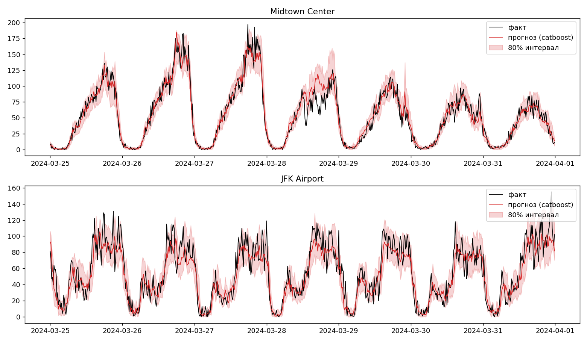
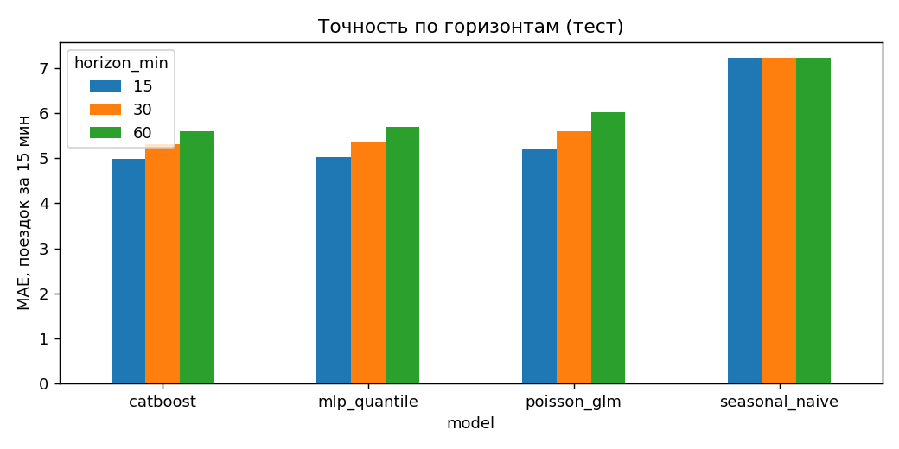
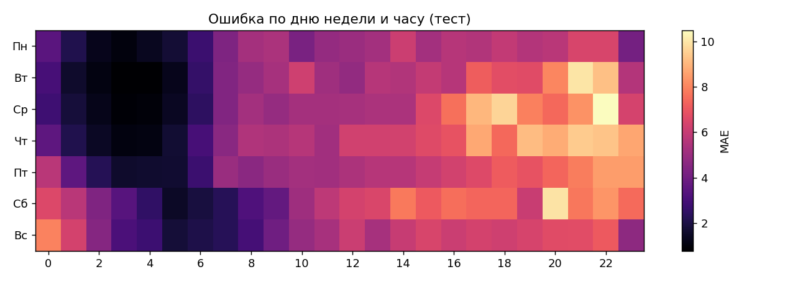

# DemandCast — short-term taxi demand forecasting with prediction intervals

**English** · [Русский](README.ru.md)

[](https://colab.research.google.com/drive/1FFTZZXznryuYXOFEaJ7MwF-1Qv84QwG3)

Forecasts NYC Yellow Taxi pickups per zone **15, 30 and 60 minutes ahead**, with **80% prediction intervals**.
Compares a statistical model, gradient boosting and a neural network, and analyses *where and why* the models fail (demand spikes, airports, rain, holidays).



## What's inside

- **Data:** NYC TLC Yellow Taxi trips (Jan–Mar 2024), aggregated to 15-minute bins per pickup zone (40 busiest zones); hourly weather from Open-Meteo; US federal holidays.
- **Models** (all produce a point forecast and a 10%–90% interval):
  | Model | Interval from |
  |---|---|
  | Seasonal naive (same slot last week) | — (baseline) |
  | Poisson GLM (scikit-learn) | Poisson quantiles |
  | CatBoost | one model per quantile (pinball loss) |
  | MLP in PyTorch with zone embeddings | 3 quantile outputs, pinball loss, trained in log1p space |
- **Spatio-temporal features:** demand of neighbouring zones (zone adjacency from the TLC shapefile), city-wide demand, lags, rolling means, same time yesterday / last week, calendar and weather.
- **Interactive map** of average demand by zone with an hour slider, plus a map of forecast error by zone.
- **Error analysis:** errors, bias and interval coverage split by hour, weekday, airport, rain, holiday, demand spike and zone.

## Setup of the experiment

- Target: pickups in the 15-minute bin `t + k·15 min` (k = 1, 2, 4), predicted at time `t` using only information up to `t`.
- Chronological split: 70% train / 15% validation / 15% test, with a gap of `k` bins between blocks to avoid target leakage.
- Test period: last ~2 weeks of March 2024 (48,400 zone-intervals).
- Metrics: MAE, RMSE, WAPE; for intervals — empirical coverage of the nominal 80% interval, mean width and interval score (lower is better).

## Results (test set)

| Horizon | Model | MAE | RMSE | WAPE | Coverage 80% | Width 80% | Interval score |
|---|---|---|---|---|---|---|---|
| 15 min | seasonal naive | 7.220 | 11.386 | 0.263 | — | — | — |
| | Poisson GLM | 5.201 | 7.932 | 0.190 | 0.737 | 12.0 | 25.07 |
| | **CatBoost** | **4.982** | **7.686** | **0.182** | 0.780 | 15.6 | **22.61** |
| | MLP (quantile) | 5.013 | 7.866 | 0.183 | 0.792 | 16.1 | 22.70 |
| 30 min | seasonal naive | 7.220 | 11.386 | 0.263 | — | — | — |
| | Poisson GLM | 5.607 | 8.651 | 0.205 | 0.711 | 12.1 | 27.87 |
| | **CatBoost** | **5.308** | **8.301** | **0.194** | 0.778 | 16.6 | **24.25** |
| | MLP (quantile) | 5.352 | 8.558 | 0.195 | 0.799 | 17.6 | 24.34 |
| 60 min | seasonal naive | 7.220 | 11.386 | 0.263 | — | — | — |
| | Poisson GLM | 6.019 | 9.312 | 0.220 | 0.684 | 12.1 | 30.73 |
| | CatBoost | **5.597** | **8.764** | **0.204** | 0.771 | 17.3 | 25.88 |
| | **MLP (quantile)** | 5.694 | 9.070 | 0.208 | 0.809 | 19.0 | **25.79** |



Takeaways:

- CatBoost and the MLP are within ~1–2% of each other on MAE and both beat the Poisson GLM by 5–7% and the seasonal-naive baseline by ~25–30%.
- The Poisson GLM's intervals are too narrow (coverage 68–74% instead of 80%): real demand is overdispersed relative to a Poisson. The MLP is the best calibrated (≈80% at all horizons); CatBoost slightly under-covers (77–78%).
- Error grows with the horizon for every model, as expected.

## Where the models fail (30 min horizon, CatBoost)

| Slice | Share of test | MAE | Bias (pred − actual) | Coverage 80% |
|---|---|---|---|---|
| No spike | 94% | 4.68 | +0.89 | 0.797 |
| **Demand spike** | 6% | **14.45** | **−13.97** | **0.504** |
| Non-airport zones | 95% | 5.04 | +0.06 | 0.780 |
| **Airports (JFK, LGA, EWR)** | 5% | **10.47** | −2.56 | 0.742 |
| Dry | 84% | 5.18 | −0.04 | 0.78 |
| Rain (> 0.1 mm/h) | 16% | 6.00 | −0.24 | 0.77 |

*Spike = demand more than ~3 Poisson standard deviations above the training average for the same zone, weekday and time slot.*

- **Spikes are the main source of error:** the model systematically under-predicts them (bias ≈ −14 trips) and the interval covers only ~50% of them.
- **Hardest zones by MAE:** JFK (11.7), LaGuardia (9.3), Penn Station (9.2), Times Sq (8.1).
- **Largest single errors** are late-evening surges (21:30–23:00) around Lincoln Square East in late March, where ~150–210 trips were observed against ~50 predicted — consistent with event-driven demand (hypothesis; events data is not used).
- Rain has a small effect (+0.8 MAE); holidays could not be assessed — the test window contains none.



## Limitations / next steps

- Single chronological split over ~3 months; no cross-validation over time, one random seed for the MLP.
- Weather at time `t` is used instead of a weather *forecast*.
- Only Yellow Taxis (no Uber/Lyft), only the 40 busiest zones.
- No event data: add event calendars (concerts, sports, flights at airports) to attack the spike errors.
- Conformal calibration of the intervals; graph neural network for the spatial part.

## Run it

```bash
git clone https://github.com/LevTsaturyan/demandcast.git
cd demandcast
pip install -r requirements.txt
python demandcast.py                 # defaults: Jan–Mar 2024, 40 zones, horizons 15/30/60 min
python demandcast.py --zones 20 --epochs 5   # quicker run
```

Or open `notebooks/demandcast.ipynb` in Colab (GPU recommended for the neural net).
Outputs go to `results/`: `metrics.csv`, plots, `demand_map.html`, `error_map.html`, `errors_by_*.csv`, `worst_errors.csv`.

## Repository structure

```
demandcast.py            # whole pipeline: data -> features -> models -> evaluation -> plots/maps
notebooks/demandcast.ipynb
assets/                  # figures used in this README
requirements.txt
```

Data sources: [NYC TLC Trip Record Data](https://www.nyc.gov/site/tlc/about/tlc-trip-record-data.page), [Open-Meteo](https://open-meteo.com/).
