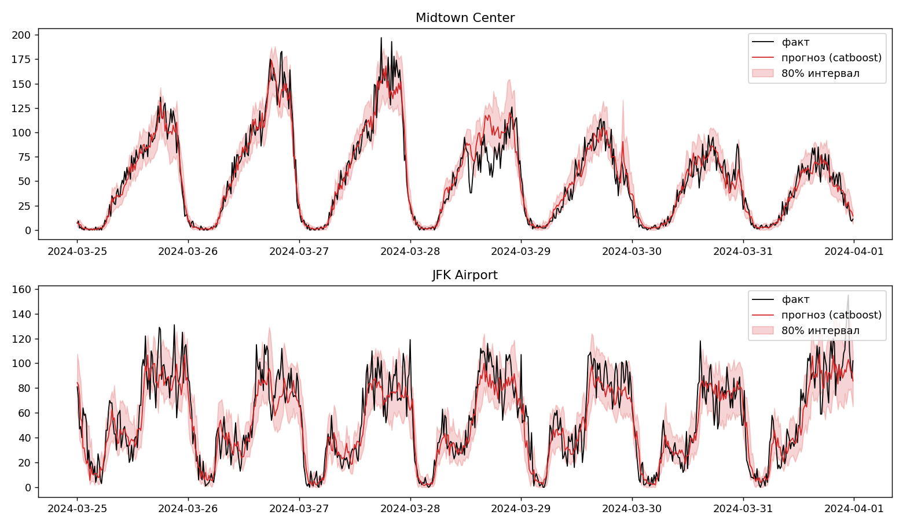
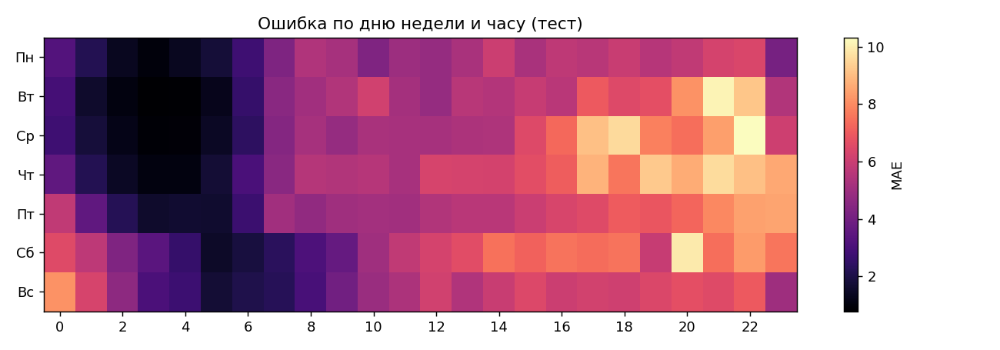

# DemandCast — short-term taxi demand forecasting with prediction intervals
**Live demo:** [(https://demandcast.streamlit.app/)] (replay of the test period; TLC data is published with a delay, so this is not real time)

**English** · [Русский](README.ru.md)

[](https://colab.research.google.com/github/LevTsaturyan/demandcast/blob/main/notebooks/demandcast.ipynb)

Forecasts NYC Yellow Taxi pickups per zone **15, 30 and 60 minutes ahead**, with **80% prediction intervals**.
Compares a statistical model, gradient boosting and a neural network, and analyses *where and why* the models fail (demand spikes, airports, rain, holidays).



## What's inside

- **Data:** NYC TLC Yellow Taxi trips (Jan–Mar 2024), aggregated to 15-minute bins per pickup zone (40 busiest zones); hourly weather from Open-Meteo; US federal holidays.
- **Models** (all produce a point forecast and a 10%–90% interval):
  | Model | Interval from |
  |---|---|
  | Persistence (last observed bin), mean of last hour, seasonal naive (same slot last week) | — (baselines) |
  | Poisson GLM (scikit-learn) | Poisson quantiles |
  | CatBoost | one model per quantile (pinball loss) |
  | CatBoost + conformal calibration | CatBoost quantiles shifted by the validation residuals (CQR) |
  | MLP in PyTorch with zone embeddings | 3 quantile outputs, pinball loss, trained in log1p space |
- **Spatio-temporal features:** demand of neighbouring zones (zone adjacency from the TLC shapefile), city-wide demand, lags, rolling means, same time yesterday / last week, calendar and weather.
- **Interactive map** of average demand by zone with an hour slider, plus a map of forecast error by zone.
- **Error analysis:** errors, bias and interval coverage split by hour, weekday, airport, rain, holiday, demand spike and zone.

## Setup of the experiment

- Target: pickups in the 15-minute bin `t + k·15 min` (k = 1, 2, 4), predicted at time `t` using only information up to `t`.
- Chronological split: 70% train / 15% validation / 15% test, with a gap of `k` bins between blocks to avoid target leakage.
- Test period: last ~2 weeks of March 2024 (48,400 zone-intervals).
- Metrics: MAE, RMSE, WAPE; for intervals — empirical coverage of the nominal 80% interval, mean width and interval score (lower is better).

## Results (test set)

| Horizon | Model | MAE | RMSE | WAPE | Coverage 80% | Interval score |
|---|---|---|---|---|---|---|
| 15 min | persistence | 6.204 | 9.395 | 0.226 | — | — |
| | mean of last hour | 6.355 | 9.689 | 0.232 | — | — |
| | seasonal naive | 7.220 | 11.386 | 0.263 | — | — |
| | Poisson GLM | 5.197 | 7.929 | 0.190 | 0.737 | 25.06 |
| | **CatBoost** | **4.979** | **7.671** | **0.182** | 0.786 | 22.71 |
| | CatBoost + conformal | 4.979 | 7.671 | 0.182 | **0.803** | 22.70 |
| | MLP (5 seeds) | 4.988 ± 0.028 | 7.770 ± 0.050 | 0.182 | 0.794 ± 0.009 | 22.43 ± 0.14 |
| 30 min | persistence | 7.150 | 11.071 | 0.261 | — | — |
| | mean of last hour | 7.331 | 11.243 | 0.268 | — | — |
| | seasonal naive | 7.220 | 11.386 | 0.263 | — | — |
| | Poisson GLM | 5.601 | 8.647 | 0.204 | 0.710 | 27.86 |
| | **CatBoost** | **5.301** | **8.281** | **0.193** | 0.778 | 24.18 |
| | CatBoost + conformal | 5.301 | 8.281 | 0.193 | **0.797** | 24.15 |
| | MLP (5 seeds) | 5.303 ± 0.031 | 8.403 ± 0.088 | 0.194 | 0.784 ± 0.023 | 23.96 ± 0.27 |
| 60 min | persistence | 8.710 | 13.404 | 0.318 | — | — |
| | mean of last hour | 9.217 | 14.124 | 0.336 | — | — |
| | seasonal naive | 7.220 | 11.386 | 0.263 | — | — |
| | Poisson GLM | 6.014 | 9.309 | 0.219 | 0.684 | 30.69 |
| | **CatBoost** | **5.581** | **8.725** | **0.204** | 0.773 | 25.86 |
| | CatBoost + conformal | 5.581 | 8.725 | 0.204 | **0.798** | 25.82 |
| | MLP (5 seeds) | 5.657 ± 0.113 | 9.060 ± 0.245 | 0.206 | 0.789 ± 0.009 | 25.70 ± 0.70 |

CatBoost is from a single run. MLP values are mean ± std over 5 seeds.

Takeaways:

- CatBoost has 20–26% lower MAE than the best simple baseline at each horizon, and 4–7% lower MAE than the Poisson GLM.
- CatBoost and the MLP are effectively tied on MAE: the gap is within the MLP's seed-to-seed spread. CatBoost has slightly lower RMSE and needs no GPU.
- Raw CatBoost intervals slightly under-cover (77–79%). Conformal calibration on the validation set brings coverage to 80–80.3% while widening the interval by only 1–2%. Validation was also used for CatBoost early stopping, so the coverage guarantee is approximate.
- The MLP's raw intervals are closer to the nominal 80%, but its advantage in interval score exceeds the seed spread only at 15 minutes.
- Poisson GLM intervals are too narrow (68–74% coverage): real demand is overdispersed relative to a Poisson.

## Stability across time windows

Rolling backtest: 3 consecutive two-week test windows (19 February – 31 March 2024); for each window the models are trained only on earlier data.

| Horizon | Model | MAE, mean ± std | Coverage 80% |
|---|---|---|---|
| 15 min | persistence | 6.093 ± 0.149 | — |
| | Poisson GLM | 5.106 ± 0.136 | 0.740 |
| | **CatBoost** | **4.929 ± 0.153** | 0.780 |
| | CatBoost + conformal | 4.929 ± 0.153 | **0.797** |
| 30 min | persistence | 7.013 ± 0.215 | — |
| | Poisson GLM | 5.527 ± 0.168 | 0.714 |
| | **CatBoost** | **5.285 ± 0.203** | 0.776 |
| | CatBoost + conformal | 5.285 ± 0.203 | **0.799** |
| 60 min | seasonal naive | 7.382 ± 0.313 | — |
| | Poisson GLM | 6.004 ± 0.212 | 0.680 |
| | **CatBoost** | **5.580 ± 0.239** | 0.769 |
| | CatBoost + conformal | 5.580 ± 0.239 | **0.802** |

- The results hold across windows: CatBoost has 19–25% lower MAE than the best simple baseline and 3–7% lower MAE than the Poisson GLM.
- After conformal calibration, coverage stays at 79.7–80.2% on every horizon.
- The MLP was not included in the backtest because it needs a GPU and much longer training.

## Where the models fail (30 min horizon, CatBoost)

| Slice | Share of test | MAE | Bias (pred − actual) | Coverage 80% |
|---|---|---|---|---|
| No spike | 93.6% | 4.68 | +0.87 | 0.797 |
| **Demand spike** | 6.4% | **14.40** | **−13.94** | **0.497** |
| Non-airport zones | 95% | 5.03 | +0.05 | 0.779 |
| **Airports (JFK, LGA)** | 5% | **10.47** | −2.45 | 0.740 |
| Dry | 84.5% | 5.19 | −0.11 | 0.780 |
| Rain (> 0.1 mm/h) | 15.5% | 5.90 | +0.07 | 0.764 |

*Spike = demand more than ~3 Poisson standard deviations above the training average for the same zone, weekday and time slot.*

- **Spikes are the main source of error:** the MAE is about 3.1 times higher than on ordinary intervals and the 80% interval covers only ~50% of them. Spikes are defined by the actual value, so part of the negative bias is expected by construction.
- **Hardest zones by MAE:** JFK (11.6), LaGuardia (9.3), Penn Station (9.3), Midtown Center (8.1).
- **8 of the 10 largest errors** are in Lincoln Square East between 21:30 and 23:30: demand jumps to 150–200 trips against a forecast of 40–65. The zone is next to Lincoln Center, so these are most likely the end of evening performances, which the model cannot see without event data.
- Rain has a small effect (+0.7 MAE); holidays could not be assessed — the test window contains none.



## Limitations / next steps

- Only ~3 months of data; the backtest covers 3 two-week windows and does not include the MLP. CatBoost was run with one seed.
- Weather at time `t` is used instead of a weather *forecast*.
- Only Yellow Taxis (no Uber/Lyft), only the 40 busiest zones.
- No event data: add event calendars (concerts, sports, flights at airports) to attack the spike errors.
- Graph neural network for the spatial part.

## Run it

```bash
git clone https://github.com/LevTsaturyan/demandcast.git
cd demandcast
pip install -r requirements.txt
python demandcast.py                 # defaults: Jan–Mar 2024, 40 zones, horizons 15/30/60 min
python demandcast.py --zones 20 --epochs 5   # quicker run
python demandcast.py --backtest      # rolling backtest over 3 two-week windows
```

Or open `notebooks/demandcast.ipynb` in Colab (GPU recommended for the neural net).
Outputs go to `results/`: `metrics.csv`, plots, `demand_map.html`, `error_map.html`, `errors_by_*.csv`, `worst_errors.csv`, `backtest.csv`.

## Repository structure

```
demandcast.py            # whole pipeline: data -> features -> models -> evaluation -> plots/maps
notebooks/demandcast.ipynb
assets/                  # figures used in this README
requirements.txt
```

Data sources: [NYC TLC Trip Record Data](https://www.nyc.gov/site/tlc/about/tlc-trip-record-data.page), [Open-Meteo](https://open-meteo.com/).
