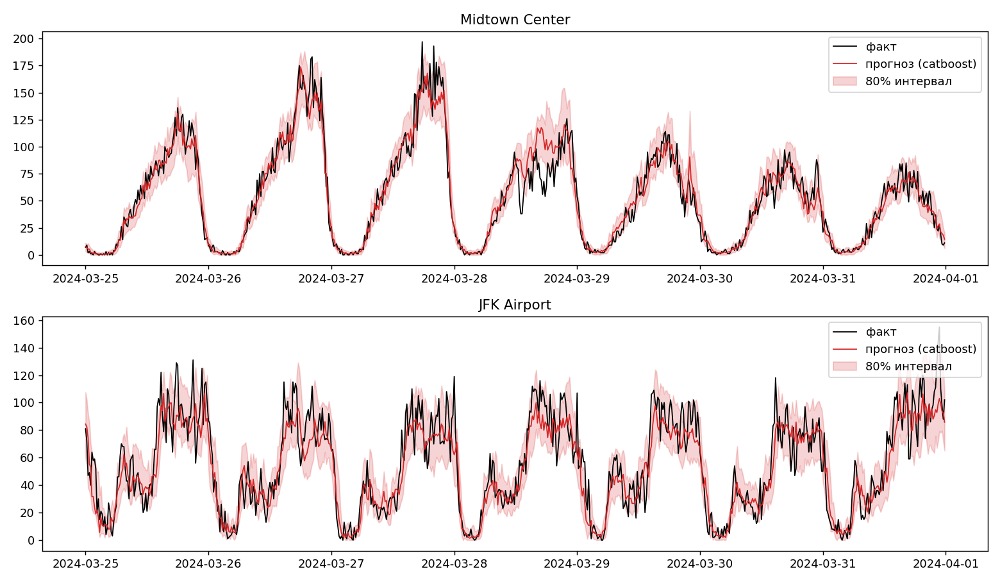
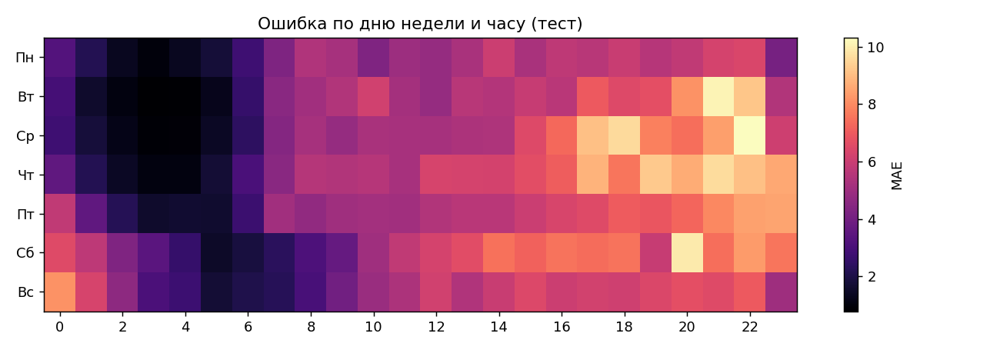

# DemandCast — краткосрочный прогноз спроса на такси с доверительными интервалами

[English](README.md) · **Русский**

[](https://colab.research.google.com/github/LevTsaturyan/demandcast/blob/main/notebooks/demandcast.ipynb)

Прогноз числа поездок NYC Yellow Taxi по районам города на **15, 30 и 60 минут вперёд** с **80% интервалами**.
Сравниваются статистическая модель, градиентный бустинг и нейросеть; отдельно разобрано, *где и почему* модели ошибаются (всплески спроса, аэропорты, дождь, праздники).



## Что внутри

- **Данные:** поездки NYC TLC Yellow Taxi (янв–март 2024), агрегированные в 15-минутные интервалы по районам посадки (40 самых загруженных районов); почасовая погода Open-Meteo; федеральные праздники США.
- **Модели** (у всех есть точечный прогноз и интервал 10%–90%):
  | Модель | Откуда интервал |
  |---|---|
  | Последнее значение, среднее за последний час, сезонный наивный (тот же слот неделю назад) | — (бейзлайны) |
  | Пуассоновская регрессия (scikit-learn) | квантили распределения Пуассона |
  | CatBoost | отдельная модель на каждый квантиль (pinball loss) |
  | CatBoost + конформная калибровка | квантили CatBoost, сдвинутые по ошибкам на validation (CQR) |
  | MLP на PyTorch с embedding района | 3 выхода-квантиля, pinball loss, обучение в шкале log1p |
- **Пространственно-временные признаки:** спрос в соседних районах (смежность из шейп-файла TLC), спрос по всему городу, лаги, скользящие средние, то же время вчера и неделю назад, календарь и погода.
- **Интерактивная карта** среднего спроса по районам с ползунком по часам и карта ошибки прогноза по районам.
- **Разбор ошибок:** ошибка, смещение и покрытие интервала по часу, дню недели, аэропортам, дождю, праздникам, всплескам спроса и районам.

## Постановка эксперимента

- Цель: число поездок в 15-минутном интервале `t + k·15 мин` (k = 1, 2, 4); прогноз делается в момент `t` только по данным до `t`.
- Хронологический сплит: 70% train / 15% validation / 15% test, между блоками зазор в `k` интервалов, чтобы цели не протекали.
- Тест: последние ~2 недели марта 2024 (48 400 наблюдений район × интервал).
- Метрики: MAE, RMSE, WAPE; для интервалов — фактическое покрытие номинальных 80%, средняя ширина и interval score (меньше — лучше).

## Результаты (тестовая выборка)

| Горизонт | Модель | MAE | RMSE | WAPE | Покрытие 80% | Interval score |
|---|---|---|---|---|---|---|
| 15 мин | последнее значение | 6.204 | 9.395 | 0.226 | — | — |
| | среднее за час | 6.355 | 9.689 | 0.232 | — | — |
| | сезонный наивный | 7.220 | 11.386 | 0.263 | — | — |
| | Пуассон GLM | 5.197 | 7.929 | 0.190 | 0.737 | 25.06 |
| | **CatBoost** | **4.979** | **7.671** | **0.182** | 0.786 | 22.71 |
| | CatBoost + калибровка | 4.979 | 7.671 | 0.182 | **0.803** | 22.70 |
| | MLP (5 сидов) | 4.988 ± 0.028 | 7.770 ± 0.050 | 0.182 | 0.794 ± 0.009 | 22.43 ± 0.14 |
| 30 мин | последнее значение | 7.150 | 11.071 | 0.261 | — | — |
| | среднее за час | 7.331 | 11.243 | 0.268 | — | — |
| | сезонный наивный | 7.220 | 11.386 | 0.263 | — | — |
| | Пуассон GLM | 5.601 | 8.647 | 0.204 | 0.710 | 27.86 |
| | **CatBoost** | **5.301** | **8.281** | **0.193** | 0.778 | 24.18 |
| | CatBoost + калибровка | 5.301 | 8.281 | 0.193 | **0.797** | 24.15 |
| | MLP (5 сидов) | 5.303 ± 0.031 | 8.403 ± 0.088 | 0.194 | 0.784 ± 0.023 | 23.96 ± 0.27 |
| 60 мин | последнее значение | 8.710 | 13.404 | 0.318 | — | — |
| | среднее за час | 9.217 | 14.124 | 0.336 | — | — |
| | сезонный наивный | 7.220 | 11.386 | 0.263 | — | — |
| | Пуассон GLM | 6.014 | 9.309 | 0.219 | 0.684 | 30.69 |
| | **CatBoost** | **5.581** | **8.725** | **0.204** | 0.773 | 25.86 |
| | CatBoost + калибровка | 5.581 | 8.725 | 0.204 | **0.798** | 25.82 |
| | MLP (5 сидов) | 5.657 ± 0.113 | 9.060 ± 0.245 | 0.206 | 0.789 ± 0.009 | 25.70 ± 0.70 |

CatBoost запущен один раз. Для MLP указаны среднее ± стандартное отклонение по 5 сидам.

Выводы:

- MAE у CatBoost на 20–26% ниже, чем у лучшего простого бейзлайна на каждом горизонте, и на 4–7% ниже, чем у пуассоновской регрессии.
- CatBoost и MLP фактически на равных по MAE: разница укладывается в разброс MLP между сидами. У CatBoost немного ниже RMSE, и ему не нужен GPU.
- Исходные интервалы CatBoost немного недопокрывают (77–79%). Конформная калибровка на validation доводит покрытие до 80–80.3%, расширяя интервал всего на 1–2%. Validation использовался и для ранней остановки CatBoost, поэтому гарантия покрытия приблизительная.
- Исходные интервалы MLP ближе к номинальным 80%, но её преимущество по interval score превышает разброс сидов только на 15 минутах.
- Интервалы пуассоновской модели слишком узкие (покрытие 68–74%): реальный спрос имеет избыточную дисперсию относительно Пуассона.

## Стабильность на разных окнах

Скользящая проверка: 3 последовательных двухнедельных тестовых окна (19 февраля – 31 марта 2024); для каждого окна модели обучаются только на более ранних данных.

| Горизонт | Модель | MAE, среднее ± std | Покрытие 80% |
|---|---|---|---|
| 15 мин | последнее значение | 6.093 ± 0.149 | — |
| | Пуассон GLM | 5.106 ± 0.136 | 0.740 |
| | **CatBoost** | **4.929 ± 0.153** | 0.780 |
| | CatBoost + калибровка | 4.929 ± 0.153 | **0.797** |
| 30 мин | последнее значение | 7.013 ± 0.215 | — |
| | Пуассон GLM | 5.527 ± 0.168 | 0.714 |
| | **CatBoost** | **5.285 ± 0.203** | 0.776 |
| | CatBoost + калибровка | 5.285 ± 0.203 | **0.799** |
| 60 мин | сезонный наивный | 7.382 ± 0.313 | — |
| | Пуассон GLM | 6.004 ± 0.212 | 0.680 |
| | **CatBoost** | **5.580 ± 0.239** | 0.769 |
| | CatBoost + калибровка | 5.580 ± 0.239 | **0.802** |

- Результаты держатся на всех окнах: MAE у CatBoost на 19–25% ниже лучшего простого бейзлайна и на 3–7% ниже пуассоновской регрессии.
- После конформной калибровки покрытие держится на уровне 79.7–80.2% на всех горизонтах.
- MLP в бэктест не включена: ей нужен GPU и намного более долгое обучение.

## Где модели ошибаются (горизонт 30 мин, CatBoost)

| Срез | Доля теста | MAE | Смещение (прогноз − факт) | Покрытие 80% |
|---|---|---|---|---|
| Без всплеска | 93.6% | 4.68 | +0.87 | 0.797 |
| **Всплеск спроса** | 6.4% | **14.40** | **−13.94** | **0.497** |
| Районы без аэропортов | 95% | 5.03 | +0.05 | 0.779 |
| **Аэропорты (JFK, LGA)** | 5% | **10.47** | −2.45 | 0.740 |
| Без дождя | 84.5% | 5.19 | −0.11 | 0.780 |
| Дождь (> 0.1 мм/ч) | 15.5% | 5.90 | +0.07 | 0.764 |

*Всплеск — спрос больше чем на ~3 пуассоновских стандартных отклонения выше среднего по train для того же района, дня недели и слота времени.*

- **Всплески — главный источник ошибки:** MAE примерно в 3.1 раза выше, чем на обычных интервалах, а 80%-интервал накрывает лишь ~50% таких точек. Всплеск определён по фактическому значению, поэтому часть отрицательного смещения следует из самого определения.
- **Самые трудные районы по MAE:** JFK (11.6), LaGuardia (9.3), Penn Station (9.3), Midtown Center (8.1).
- **8 из 10 самых больших ошибок** приходятся на Lincoln Square East с 21:30 до 23:30: спрос вырастает до 150–200 поездок при прогнозе 40–65. Район находится рядом с Lincoln Center, поэтому вероятнее всего это окончание вечерних спектаклей и концертов, которое модель без данных о мероприятиях не видит.
- Дождь влияет слабо (+0.7 к MAE); праздники оценить нельзя — в тестовом окне их нет.



## Ограничения и что улучшить

- Всего ~3 месяца данных; бэктест охватывает 3 двухнедельных окна и не включает MLP. CatBoost запущен с одним сидом.
- Используется фактическая погода в момент `t`, а не *прогноз* погоды.
- Только Yellow Taxi (без Uber/Lyft) и только 40 самых загруженных районов.
- Нет данных о событиях: добавить календари мероприятий (концерты, спорт, рейсы в аэропортах), чтобы уменьшить ошибки на всплесках.
- Графовая нейросеть для пространственной части.

## Запуск

```bash
git clone https://github.com/LevTsaturyan/demandcast.git
cd demandcast
pip install -r requirements.txt
python demandcast.py                 # по умолчанию: янв–март 2024, 40 районов, горизонты 15/30/60 мин
python demandcast.py --zones 20 --epochs 5   # быстрый запуск
python demandcast.py --backtest      # скользящая проверка на 3 двухнедельных окнах
```

Или открой `notebooks/demandcast.ipynb` в Colab (для нейросети лучше с GPU).
Результаты сохраняются в `results/`: `metrics.csv`, графики, `demand_map.html`, `error_map.html`, `errors_by_*.csv`, `worst_errors.csv`, `backtest.csv`.

## Структура репозитория

```
demandcast.py            # весь пайплайн: данные -> признаки -> модели -> оценка -> графики и карты
notebooks/demandcast.ipynb
assets/                  # картинки для README
requirements.txt
```

Источники данных: [NYC TLC Trip Record Data](https://www.nyc.gov/site/tlc/about/tlc-trip-record-data.page), [Open-Meteo](https://open-meteo.com/).
